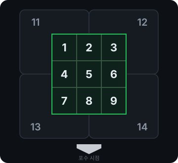

# openScoreBook

야구장에서 폰으로 쓰는 야구 스코어북. 투구 하나하나(위치·구종·구속·판정)와 타구 낙구지점까지 기록한다.
오프라인에서 동작하는 PWA이고, 스코어링 엔진은 Rust로 짜서 WASM으로 돌린다.

### PC


| 투수 분석 · 투구 기록지 | 기록지 |
| :-: | :-: |
|  |  |

### 폰

| 기록 입력 | 투수 분석 · 투구 기록지 | 차팅 · 낙구지점 |
| :-: | :-: | :-: |
|  |  |  |

| 기록지 | 박스스코어 |
| :-: | :-: |
|  |  |

스크린샷은 가상의 팀과 선수로 직접 기록한 경기다.

## 기능

### 직접 기록

경기 설정에서 날짜, 구장, 두 팀 이름, 타순 9명과 포지션, 선발 투수를 넣고 시작한다. 이름을 비워 두면 `청룡1번`처럼 팀 이름과 타순으로 채운다.

| 입력 | 내용 |
| --- | --- |
| 투구 | 스트라이크존을 탭해 위치를 찍고, 구종·구속을 넣은 뒤 판정(볼, 스트라이크, 헛스윙, 파울, 타격)을 누른다. 위치·구종·구속은 비워도 된다 |
| 자동 처리 | 볼 4개면 볼넷, 스트라이크 3개면 삼진으로 타석이 끝난다. 2스트라이크 뒤 파울은 카운트를 올리지 않는다 |
| 사구 · 고의4구 | 버튼 하나로 타석을 끝낸다 |
| 타석 결과 | 안타, 땅볼, 플라이, 라이너, 병살, 야수선택, 실책, 희생플라이, 희생번트, 삼진, 볼넷, 사구 중에서 고른다. 공이 간 순서대로 야수를 누르면 `6-4-3`처럼 기록된다 |
| 주자 이동 | 결과에 맞는 기본 이동이 미리 채워지고, 주자별로 1루·2루·3루·홈·아웃을 바꿀 수 있다. 실책으로 간 진루는 따로 표시한다 |
| 주루 플레이 | 도루, 도루실패, 폭투, 포일, 보크, 견제사, 기타 |
| 교체 | 대타, 대주자, 투수, 수비 |
| 되돌리기 | 마지막 입력부터 하나씩 취소한다. 자동으로 끝난 볼넷·삼진은 그 공까지 함께 취소된다 |

### 차팅

타석마다 투구 위치와 공 목록을 보여 주고, 타격한 타석은 필드에 타구를 기록한다.

- 첫 탭은 낙구지점, 이어지는 탭은 그 뒤 타구 흐름이다. 홈에서의 거리와 그 방향 펜스까지의 거리, 낙구 뒤 이동 거리를 바로 보여 준다.
- 결과(1루타, 2루타, 3루타, 홈런, 아웃, 실책, 야선·희생)는 자동으로 잡히고 직접 고칠 수 있다. 궤적은 땅볼, 라이너, 플라이, 번트 중에서 고른다.
- PC에서는 왼쪽에 타석 목록이 붙고, `←` `→`로 타석을 옮기고 `N`으로 다음 인플레이 타석으로 간다.
- `JSON 복사`는 이 경기의 입력 기록 전체를 클립보드에 복사한다.

### 기록지 · 로그 · 박스스코어

- **기록지**: 타순과 이닝으로 된 전통적인 스코어시트. 칸을 누르면 그 타석으로 간다. 득점한 타석에는 점이 찍힌다.
- **로그**: 이닝별 타석 목록과 공 순서.
- **박스스코어**: 이닝별 점수, 타자 기록(타수, 안타, 타점, 득점, 볼넷, 삼진), 투수 기록(이닝, 투구 수, 피안타, 삼진, 볼넷, 자책). 입력을 엔진으로 다시 계산해 점수와 타격 기록이 맞는지 화면에 표시한다. 자책점은 실책·포일로 나온 득점을 빼는 근사값이다.

### 투수 분석

투수별로 이닝, 투구 수, 삼진, 스트라이크 비율, 구종별 비율과 평균·최고 구속, 투구 위치 분포를 보여 주고, 그 아래에 스카우트 방식의 투구 기록지가 붙는다.

투구 기록지는 한 행이 한 타석, 한 칸이 공 하나다. 칸에는 던지기 전 카운트, 구종, 판정, 구속, 코스 번호가 들어간다.

| 글자 | 판정 | | 글자 | 판정 |
| :-: | --- | --- | :-: | --- |
| `B` | 볼 | | `F` | 파울 |
| `C` | 루킹 스트라이크 | | `L` | 번트 파울 |
| `S` | 헛스윙 | | `X` | 타격 |

코스 번호는 포수 시점이다. 존 안은 1–9, 존 밖은 네 방향으로 나눈 11–14이다. 공이 존에 조금이라도 걸치면 존 안으로 본다(KBO ABS처럼 홈플레이트 좌우 2cm 여유 포함).



### 기록 표기

| 표기 | 뜻 | | 표기 | 뜻 |
| --- | --- | --- | --- | --- |
| `1B` `2B` `3B` `HR` | 안타, 장타, 홈런 | | `F8` `L6` | 플라이, 라이너 (숫자는 야수) |
| `BB` `IBB` `HBP` | 볼넷, 고의4구, 사구 | | `SF8` `SAC 1-3` | 희생플라이, 희생번트 |
| `K` / `ꓘ` | 헛스윙·파울 삼진 / 루킹 삼진 | | `6-4-3 DP` | 병살 |
| `6-3` `3U` | 땅볼 (야수 순서) / 혼자 처리한 아웃 | | `E6` `FC` | 실책, 야수선택 |
| `G` | 야수를 고르지 않은 땅볼 | | | |

야수 번호: 1 투수, 2 포수, 3 1루수, 4 2루수, 5 3루수, 6 유격수, 7 좌익수, 8 중견수, 9 우익수.

### 구장

잠실, 문학, 수원, 사직, 창원, 대전, 광주, 대구, 고척 9개 구장의 펜스 거리가 들어 있다. VWorld 위성사진에서 따낸 윤곽이 있는 구장은 1도 단위로 펜스 거리를 계산한다. 저장소에는 수치만 있고 사진은 없다. 구장을 `기타`로 고르면 기본 펜스로 그린다.

목록에 없는 구장(사회인 야구장 등)은 `직접 입력`으로 만든다. 이름과 좌·중·우 펜스 거리를 넣으면 되고, 좌중·우중은 비워 두면 추정해서 `*`로 표시한다. 필드는 구장 크기에 맞춰 그리고, 만든 구장은 다음 경기의 구장 목록에 나온다. 펜스 수치는 경기마다 함께 저장되므로 나중에 같은 이름으로 고쳐도 지난 경기는 바뀌지 않는다. 측정 방법은 [tools/park_fence/README.md](tools/park_fence/README.md)에 있다.

### 저장 · 오프라인

- 서버와 계정이 없다. 모든 입력은 브라우저의 IndexedDB에 순서대로 쌓이고, 화면은 그 기록을 다시 계산해 그린다.
- 기록은 그 브라우저에만 있다. 다른 기기로 가져오는 기능은 아직 없다.
- PWA라서 한 번 열면 앱 화면이 캐시되어 네트워크 없이 열린다. 서비스 워커는 HTTPS나 `localhost`에서만 동작한다.
- 폭 1024px 이상이면 PC 화면으로 바뀐다.

## 실행

Node.js, Rust, [wasm-pack](https://rustwasm.github.io/wasm-pack/)이 필요하다.

```sh
git clone https://github.com/SpaceDLFactory/openScoreBook.git
cd openScoreBook/app
npm install
npm run engine   # ../engine (Rust)을 WASM으로 빌드해 src/engine에 넣는다. 엔진을 고치면 다시 실행
npm run dev      # http://localhost:5173
```

처음 열면 가상의 예시 경기(청룡 vs 백호)가 하나 들어 있다. 이어서 기록해 봐도 되고, `＋ 새 기록`으로 새 경기를 시작하면 된다.

```sh
npm test            # vitest
npm run check       # svelte-check + tsc
npm run build       # app/dist에 배포용 정적 파일 생성
(cd ../engine && cargo test)   # 엔진 단위 테스트
```

## 구조

| 경로 | 내용 |
| --- | --- |
| `app/` | Svelte 5 + Vite + TypeScript PWA |
| `app/src/views/` | 화면: 기록, 차팅, 기록지, 로그, 박스, 투수, 경기 설정 |
| `app/src/lib/manual.ts` | 직접 기록 입력을 경기 데이터로 변환 |
| `app/src/lib/store.ts` · `events.ts` | IndexedDB 이벤트 로그 |
| `app/src/lib/notation.ts` · `scout.ts` · `stadiums.ts` | 기록 표기, 코스 번호, 구장 펜스 |
| `engine/` | Rust 스코어링 엔진. 이벤트를 재생해 점수·주자·박스를 계산하는 순수 함수, WASM으로 컴파일 |
| `tools/park_fence/` | 위성사진에서 펜스 윤곽을 재는 도구 |
| `*.dc.html` · `canvas.json` · `web/` | 초기 디자인 시안과 프로토타입 |

## 라이선스

[GNU Affero General Public License v3.0 or later](LICENSE) (AGPL-3.0-or-later).
고친 버전을 네트워크로 다른 사람에게 서비스한다면 그 사람들에게 소스도 공개해야 한다.

Copyright (C) 2026 SpaceDLFactory
