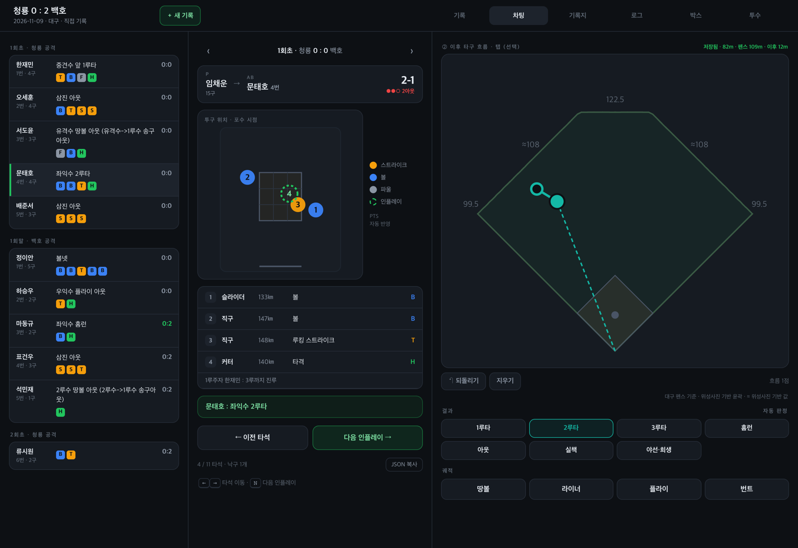
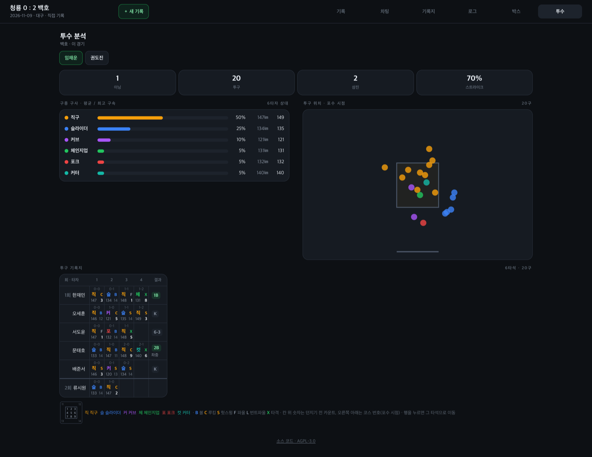
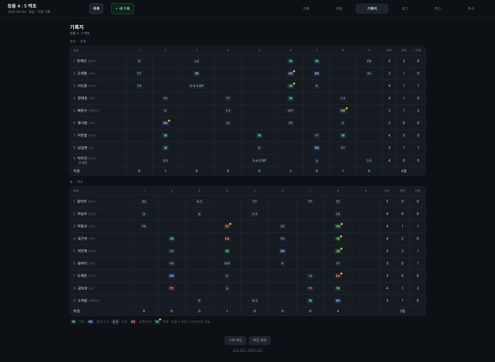
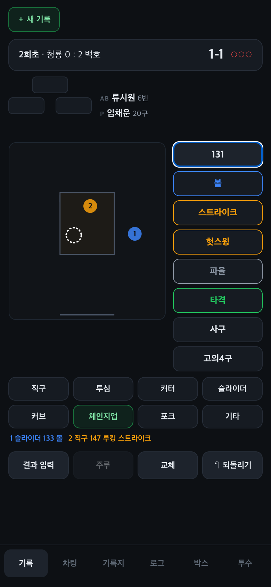
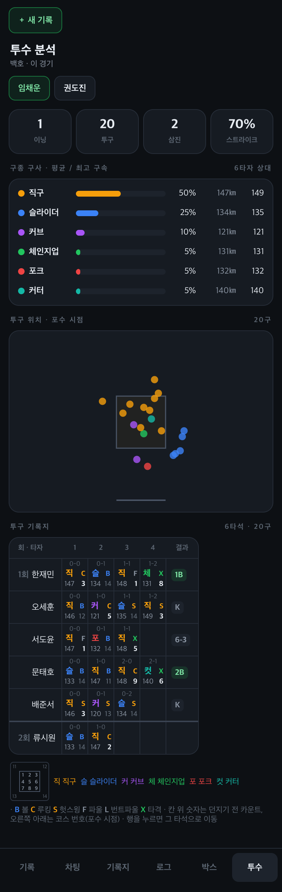
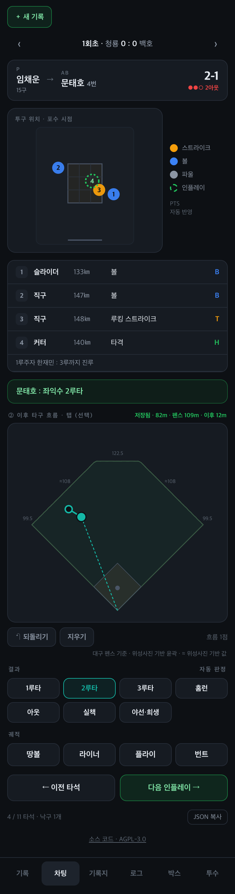
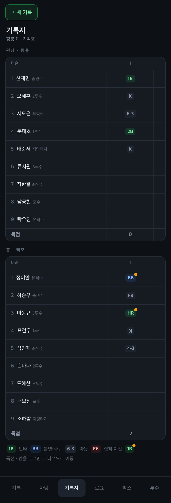
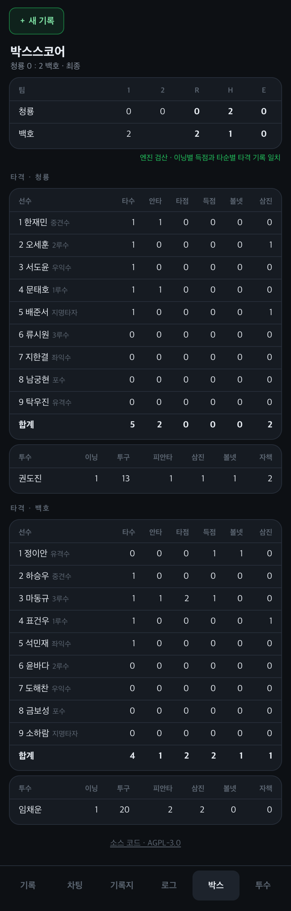

# openScoreBook

야구장에서 폰으로 쓰는 KBO 스코어북. 투구 하나하나(위치·구종·구속·판정)와 타구 낙구지점까지 기록한다.
오프라인에서 동작하는 PWA이고, 스코어링 엔진은 Rust로 짜서 WASM으로 돌린다.

### PC



| 투수 분석 · 투구 기록지 | 기록지 |
| :-: | :-: |
|  |  |

### 폰

| 기록 입력 | 투수 분석 · 투구 기록지 | 차팅 · 낙구지점 |
| :-: | :-: | :-: |
|  |  |  |

| 기록지 | 박스스코어 |
| :-: | :-: |
|  |  |

스크린샷은 가상의 팀과 선수로 직접 기록한 경기다.

## 기능

- **직접 기록**: 스트라이크존을 탭해 위치를 찍고 구종·구속·판정을 넣는다. 타석 결과는 공이 간 야수 순서로,
  도루·폭투·견제사 같은 주루 플레이와 교체도 기록한다. 볼넷과 삼진은 카운트에서 저절로 끝난다.
- **보기**: 기록지(6-3, F8, ꓘ …), 박스스코어(엔진으로 다시 계산해 맞는지 검산), 플레이 로그,
  투수 분석과 스카우트식 투구 기록지(던지기 전 카운트, 구종, 판정, 구속, 코스 1–9 / 11–14).
- **구장**: VWorld 위성사진에서 따낸 펜스 윤곽으로 타구 거리와 펜스까지 거리를 보여 준다. 저장소에는 수치만 있고 사진은 없다.
- 모든 입력은 IndexedDB 이벤트 로그로 남아 되돌리기가 되고, 네트워크 없이도 쓸 수 있다.

## 실행

Node.js, Rust, [wasm-pack](https://rustwasm.github.io/wasm-pack/)이 필요하다.

```sh
cd app
npm install
npm run engine   # ../engine (Rust)을 WASM으로 빌드해 src/engine에 넣는다
npm run dev      # http://localhost:5173
npm test
```

첫 화면의 `＋ 새 기록`으로 기록을 시작한다.

## 라이선스

[GNU Affero General Public License v3.0 or later](LICENSE) (AGPL-3.0-or-later).
고친 버전을 네트워크로 다른 사람에게 서비스한다면 그 사람들에게 소스도 공개해야 한다.

Copyright (C) 2026 SpaceDLFactory
